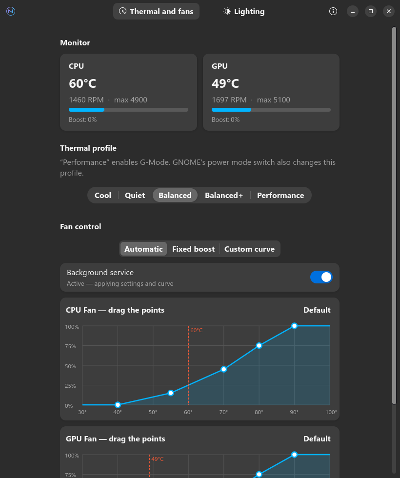
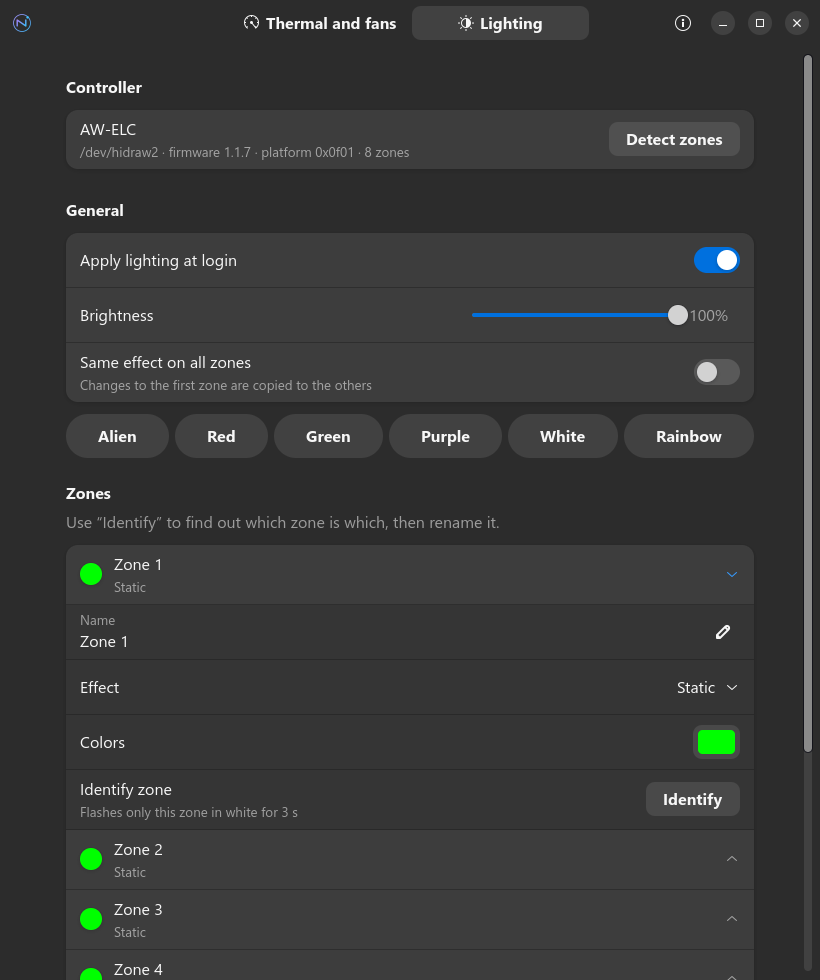

<div align="center">


# Nova Control

**Controle de fans, perfis térmicos e iluminação RGB para notebooks Alienware no Linux.**

Uma alternativa nativa ao Alienware Command Center, feita para o GNOME.

[English](README.md) · **Português**


</div>

---

<p align="center">
  
  
</p>

## Recursos

### 🌡️ Térmico e fans
- **Monitor em tempo real** de temperatura (CPU/GPU) e rotação das fans
- **Perfis térmicos do firmware**: Frio, Silencioso, Equilibrado, Equilibrado+ e Desempenho (ativa o **G-Mode**)
- **Três modos de controle das fans**:
  - **Automático**: o firmware decide
  - **Boost fixo**: velocidade extra definida por você, por fan
  - **Curva personalizada**: arraste os pontos de um gráfico temperatura × velocidade

### 💡 Iluminação RGB
- Efeitos **estático, respiração, piscar, transição entre 2 cores, espectro, onda arco-íris** e desligado
- Controle de **brilho**, **velocidade** e **cores**, por zona ou em todas juntas
- Botão **Identificar**, que pisca uma zona por vez para você descobrir qual LED é qual e dar nome a ele
- Cores prontas com um clique

### ⚙️ Em segundo plano
- **Serviço de usuário (systemd)** que reaplica suas configurações no login e ao voltar da suspensão
- A curva de fans continua funcionando **com o app fechado**
- **Linha de comando** completa para scripts e atalhos

## Compatibilidade

| Testado em | |
|---|---|
| Notebook | Alienware m15 R6 |
| Sistema | Ubuntu 26.04 (GNOME) |
| Kernel | 7.0 |

Outros modelos Alienware recentes devem funcionar se:

- o kernel carregar o driver `alienware_wmi` com suporte a AWCC (fans e perfis; kernel 6.15 ou mais novo);
- o notebook tiver o controlador de LEDs **AW-ELC** (USB `187c:0550` ou `187c:0551`).

Confira com:

```bash
lsusb | grep 187c
```

```bash
cat /sys/class/platform-profile/*/name
```

> [!NOTE]
> Testou em outro modelo? [Abra um relato de compatibilidade](https://github.com/joaopedromoraez/nova-control/issues/new?template=compatibility.yml) contando se funcionou, mesmo que parcialmente. Isso ajuda a ampliar a lista de compatibilidade.

## Instalação

### Dependências

No Ubuntu/Debian (já vêm instaladas no Ubuntu com GNOME):

```bash
sudo apt install python3 python3-gi gir1.2-gtk-4.0 gir1.2-adw-1
```

O app requer GTK 4.14+ e libadwaita 1.7+.

### Instalar

```bash
git clone https://github.com/joaopedromoraez/nova-control.git
cd nova-control
sudo ./install/install.sh
```

O instalador:

1. copia o app para `/opt/nova-control` e cria o comando `nova-control`;
2. instala as **regras udev** que permitem controlar o hardware **sem root** (acesso para o grupo `plugdev`);
3. adiciona o atalho no menu de aplicativos e os ícones;
4. ativa o serviço de usuário `nova-control.service`.

Depois é só abrir **Nova Control** no menu de aplicativos.

> [!TIP]
> Se o seu usuário não estava no grupo `plugdev`, o instalador o adiciona. Nesse caso, saia e entre de novo na sessão.

## Linha de comando

```bash
nova-control                       # abre a interface gráfica
nova-control status                # temperaturas, fans, perfil e LEDs
nova-control profile performance  # perfil térmico (ativa o G-Mode)
nova-control boost 1 60            # fan 1 (CPU) com 60% de boost
nova-control light static 00b4ff --brightness 80
nova-control light morph ff0000 --color2 0000ff --speed 70
nova-control light wave            # onda arco-íris
nova-control identify 0            # pisca só a zona 0
```

## Como funciona

O Nova Control não usa drivers próprios: ele conversa diretamente com interfaces que o kernel Linux já oferece.

| Função | Interface |
|---|---|
| Perfis térmicos e G-Mode | `/sys/class/platform-profile/*/profile` (driver `alienware_wmi`) |
| Velocidade das fans | `/sys/class/hwmon/<alienware_wmi>/fanN_boost` (0–255) |
| Temperaturas e RPM | `/sys/class/hwmon/<alienware_wmi>/{temp,fan}N_input` |
| Iluminação RGB | `/dev/hidrawN` do controlador AW-ELC, protocolo ELC via *feature reports* HID de 33 bytes |

```
nova-control/
├── nova_control/
│   ├── gui.py        # interface GTK4 / libadwaita
│   ├── thermal.py    # perfis, fans e sensores (sysfs)
│   ├── lighting.py   # driver userspace do AW-ELC
│   ├── daemon.py     # serviço: reaplica configurações e roda a curva
│   ├── config.py     # ~/.config/nova-control/config.json
│   └── cli.py        # linha de comando
├── data/icons/       # ícones do app
├── install/          # instalador, regras udev, .desktop e serviço systemd
└── bin/nova-control
```

## Observações

- O seletor **Modo de energia** do GNOME também altera o perfil térmico. Vale a última escolha feita, no GNOME ou no Nova Control.
- No modo **Boost fixo** o firmware é colocado no perfil `custom`, onde o controle manual das fans é confiável.
- As configurações ficam em `~/.config/nova-control/config.json`.

## Desinstalar

```bash
systemctl --user disable --now nova-control.service
```

```bash
sudo rm -rf /opt/nova-control /usr/local/bin/nova-control /etc/udev/rules.d/99-nova-control.rules /usr/share/applications/io.github.nova_control.desktop /usr/lib/systemd/user/nova-control.service /usr/share/icons/hicolor/scalable/apps/io.github.nova_control*.svg /usr/share/icons/hicolor/symbolic/apps/io.github.nova_control-symbolic.svg
```

## Créditos

O protocolo do controlador AW-ELC foi documentado pelos projetos [OpenRGB](https://gitlab.com/CalcProgrammer1/OpenRGB) e [alienfx-tools](https://github.com/T-Troll/alienfx-tools). O suporte a fans e perfis vem do driver `alienware-wmi` do kernel Linux.

*Alienware é marca registrada da Dell Inc. Este projeto não tem afiliação com a Dell nem com a Alienware.*

## Licença

Distribuído sob a [licença MIT](LICENSE).

Se o Nova Control foi útil, deixe uma ⭐ no repositório: isso ajuda outras pessoas com notebooks Alienware a encontrá-lo.
