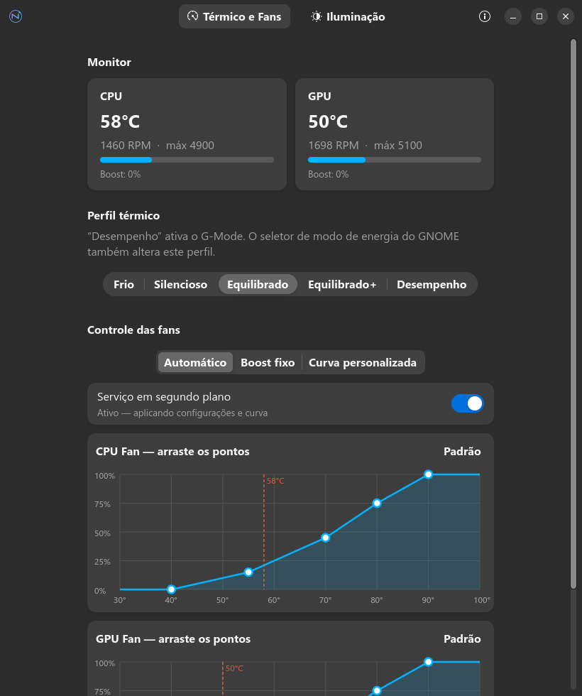
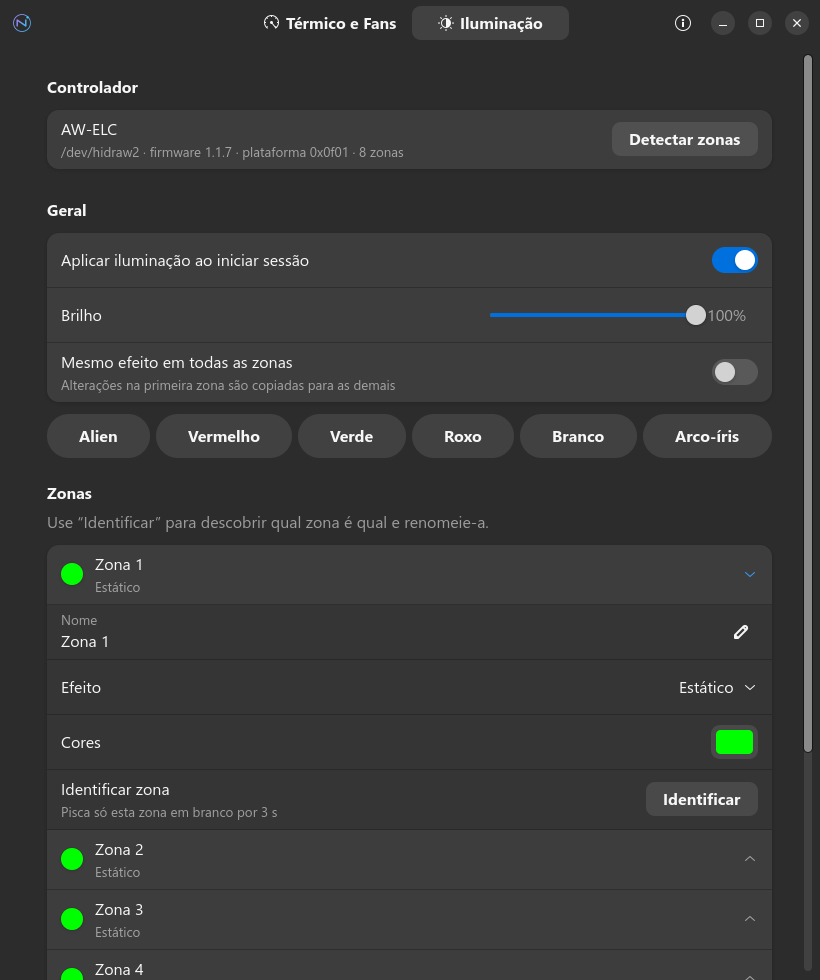

<div align="center">


# Nova Control

**Controle de fans, perfis térmicos e iluminação RGB para notebooks Alienware no Linux.**

Uma alternativa nativa ao Alienware Command Center, feita para o GNOME.

[English](README.md) · **Português**


</div>

---

<p align="center">
  
  
</p>

## Recursos

### 🌡️ Térmico e fans
- **Monitor em tempo real** de temperatura (CPU/GPU) e rotação das fans
- **Perfis térmicos do firmware**: Frio, Silencioso, Equilibrado, Equilibrado+ e Desempenho (ativa o **G-Mode**)
- **Três modos de controle das fans**:
  - **Automático**: o firmware decide
  - **Boost fixo**: velocidade extra definida por você, por fan
  - **Curva personalizada**: arraste os pontos de um gráfico temperatura × velocidade

### 💡 Iluminação RGB
- Efeitos **estático, respiração, piscar, transição entre 2 cores, espectro, onda arco-íris** e desligado
- Controle de **brilho**, **velocidade** e **cores**, por zona ou em todas juntas
- Botão **Identificar**, que pisca uma zona por vez para você descobrir qual LED é qual e dar nome a ele
- Cores prontas com um clique

### ⚙️ Em segundo plano
- **Serviço de usuário (systemd)** que reaplica suas configurações no login e ao voltar da suspensão
- A curva de fans continua funcionando **com o app fechado**
- **Linha de comando** completa para scripts e atalhos

### 🌍 Vários idiomas
- Interface em **inglês**, **português do Brasil** e **espanhol**, escolhida automaticamente pelo idioma do sistema ou nas **Preferências**

## Compatibilidade

| Testado em | |
|---|---|
| Notebook | Alienware m15 R6 |
| Sistema | Ubuntu 26.04 (GNOME) |
| Kernel | 7.0 |

Outros modelos Alienware recentes devem funcionar se:

- o kernel carregar o driver `alienware_wmi` com suporte a AWCC (fans e perfis; kernel 6.15 ou mais novo);
- o notebook tiver o controlador de LEDs **AW-ELC** (USB `187c:0550` ou `187c:0551`).

Confira com:

```bash
lsusb | grep 187c
```

```bash
cat /sys/class/platform-profile/*/name
```

> [!NOTE]
> Testou em outro modelo? [Abra um relato de compatibilidade](https://github.com/joaopedromoraez/nova-control/issues/new?template=compatibility.yml) contando se funcionou, mesmo que parcialmente. Isso ajuda a ampliar a lista de compatibilidade.

## Instalação

Requer **GTK 4.14+** e **libadwaita 1.7+**: Ubuntu 25.04+, Fedora 42+, Debian 13+, Arch Linux e derivados.

### Pacotes (recomendado)

Baixe o pacote da sua distro na [última release](https://github.com/joaopedromoraez/nova-control/releases/latest) e instale:

| Distro | Comando |
|---|---|
| Ubuntu, Debian, Pop!_OS, Mint | `sudo apt install ./nova-control_*_all.deb` |
| Fedora, Nobara | `sudo dnf install ./nova-control-*.noarch.rpm` |
| Arch, Manjaro, CachyOS | `sudo pacman -U nova-control-*-any.pkg.tar.zst` |

O pacote:

1. instala as **regras udev** que permitem controlar o hardware **sem root** (acesso para o grupo `plugdev`);
2. adiciona ao grupo `plugdev` o usuário que fez a instalação;
3. ativa o serviço de usuário `nova-control.service` para todos os usuários.

Saia e entre de novo na sessão uma vez, depois abra **Nova Control** no menu de aplicativos.

### A partir do código

```bash
git clone https://github.com/joaopedromoraez/nova-control.git
cd nova-control
sudo ./install/install.sh
```

Isso instala em `/usr/local`, com o mesmo layout dos pacotes. Para remover: `sudo ./install/install.sh --uninstall`.

## Linha de comando

```bash
nova-control                       # abre a interface gráfica
nova-control status                # temperaturas, fans, perfil e LEDs
nova-control profile performance  # perfil térmico (ativa o G-Mode)
nova-control boost 1 60            # fan 1 (CPU) com 60% de boost
nova-control light static 00b4ff --brightness 80
nova-control light morph ff0000 --color2 0000ff --speed 70
nova-control light wave            # onda arco-íris
nova-control identify 0            # pisca só a zona 0
```

## Como funciona

O Nova Control não usa drivers próprios: ele conversa diretamente com interfaces que o kernel Linux já oferece.

| Função | Interface |
|---|---|
| Perfis térmicos e G-Mode | `/sys/class/platform-profile/*/profile` (driver `alienware_wmi`) |
| Velocidade das fans | `/sys/class/hwmon/<alienware_wmi>/fanN_boost` (0–255) |
| Temperaturas e RPM | `/sys/class/hwmon/<alienware_wmi>/{temp,fan}N_input` |
| Iluminação RGB | `/dev/hidrawN` do controlador AW-ELC, protocolo ELC via *feature reports* HID de 33 bytes |

```
nova-control/
├── nova_control/
│   ├── gui.py        # interface GTK4 / libadwaita
│   ├── thermal.py    # perfis, fans e sensores (sysfs)
│   ├── lighting.py   # driver userspace do AW-ELC
│   ├── daemon.py     # serviço: reaplica configurações e roda a curva
│   ├── config.py     # ~/.config/nova-control/config.json
│   └── cli.py        # linha de comando
├── data/             # regras udev, serviço systemd, .desktop, metainfo AppStream e ícones
├── po/               # traduções (.po) e o script de atualização
├── packaging/        # layout de instalação, configuração do nFPM e scripts do pacote
├── install/          # instalação a partir do código
└── bin/nova-control
```

## Observações

- O seletor **Modo de energia** do GNOME também altera o perfil térmico. Vale a última escolha feita, no GNOME ou no Nova Control.
- No modo **Boost fixo** o firmware é colocado no perfil `custom`, onde o controle manual das fans é confiável.
- As configurações ficam em `~/.config/nova-control/config.json`.

## Idiomas

Por padrão, o Nova Control segue o idioma do sistema (`LANGUAGE`, `LC_ALL`, `LC_MESSAGES` ou `LANG`) e usa o inglês quando não há tradução. Para escolher outro, abra o menu principal (☰) → **Preferências** (<kbd>Ctrl</kbd>+<kbd>,</kbd>) → **Idioma da interface**. A escolha vale também para a linha de comando.

| Idioma | Arquivo |
|---|---|
| English | embutido |
| Português (Brasil) | [`po/pt_BR.po`](po/pt_BR.po) |
| Español | [`po/es.po`](po/es.po) |

Com o idioma em **Automático**, dá para testar outro só numa execução: `LANGUAGE=es nova-control`.

### Contribuindo com uma tradução

1. Crie o arquivo do seu idioma (por exemplo, francês): `python3 po/update.py --new fr`
2. Traduza o `po/fr.po` em qualquer editor de `.po`, como o [Poedit](https://poedit.net/), ou num editor de texto. Mantenha marcadores como `{path}` sem alteração.
3. Confira se nada ficou faltando: `python3 po/update.py --check`
4. Abra um pull request.

Depois de mudar textos no código, rode `python3 po/update.py` para atualizar o modelo e todos os `.po`.

## Desinstalar

Use o gerenciador de pacotes, por exemplo `sudo apt remove nova-control`, `sudo dnf remove nova-control` ou `sudo pacman -R nova-control`. Suas configurações ficam em `~/.config/nova-control/`.

## Créditos

O protocolo do controlador AW-ELC foi documentado pelos projetos [OpenRGB](https://gitlab.com/CalcProgrammer1/OpenRGB) e [alienfx-tools](https://github.com/T-Troll/alienfx-tools). O suporte a fans e perfis vem do driver `alienware-wmi` do kernel Linux.

*Alienware é marca registrada da Dell Inc. Este projeto não tem afiliação com a Dell nem com a Alienware.*

## Licença

Distribuído sob a [licença MIT](LICENSE).

Se o Nova Control foi útil, deixe uma ⭐ no repositório: isso ajuda outras pessoas com notebooks Alienware a encontrá-lo.
